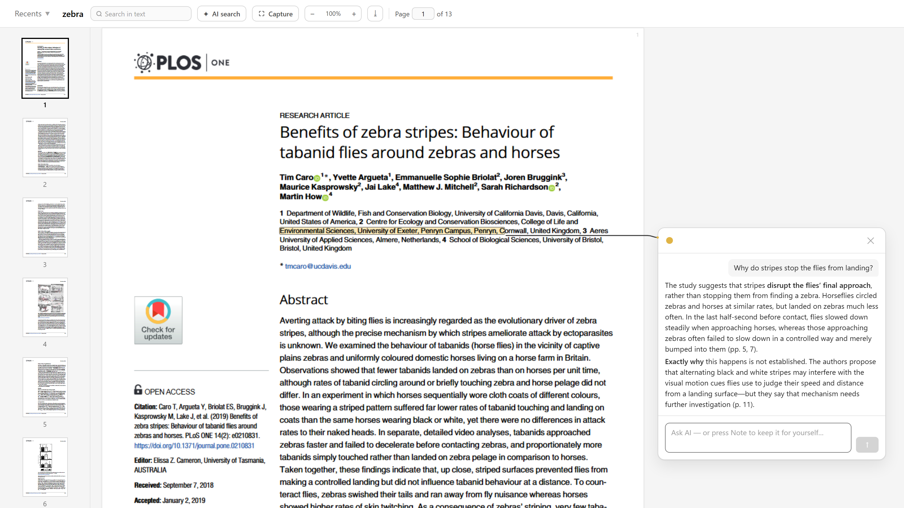
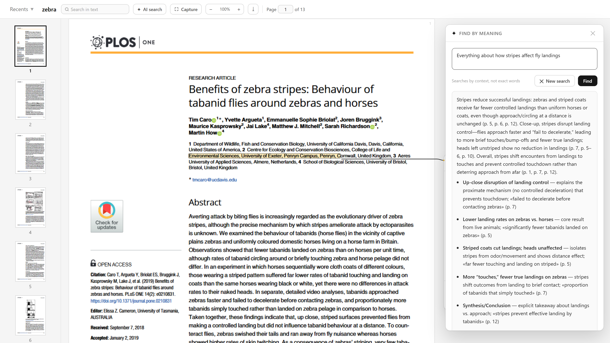
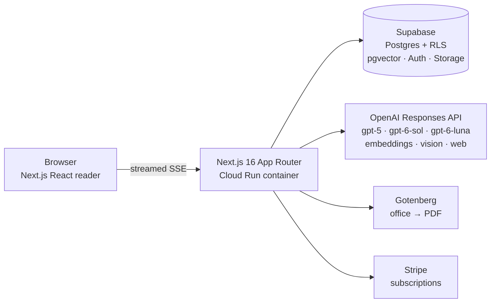

# Read Deeper

**Deep reading with AI in the margin.** Select any passage in a document → ask → get a private AI conversation anchored to that exact spot. One highlight = one thread; threads are isolated, persistent, and never bleed into each other.

**▶ Try it right now, no sign-up:** [Live demo](https://read-deeper-740826075015.europe-west1.run.app/demo) — one click creates a throwaway workspace with a sample paper loaded. Highlight something, ask the AI, run an AI search. Every visitor gets an isolated copy; workspaces self-delete after 24h.



## What it does

- **Faithful reading** — documents render as their original pages (pdf.js canvas + invisible text layer), not reflowed text. 10 input formats (PDF, DOCX, DOC, EPUB, MOBI, TXT, RTF, ODT, HTML, PPTX); office formats are converted once to PDF server-side so what is stored always matches what is displayed.
- **Anchored AI threads** — a highlight is stored as exact character offsets into the document's canonical text, plus a quote/prefix/suffix fallback for re-anchoring. Overlays are measured with `Range.getBoundingClientRect` — 0.00–0.02 px drift, including cross-page selections.
- **Isolated context by design** — each thread's AI context is its passage, ~600 surrounding characters, and its own history. Threads never see each other. This is both a product decision (no contamination) and a cost decision (small contexts).
- **AI search that proves its coverage** — answer-first results (short synthesis → ranked key places → complete inventory behind a fold), where every finding carries a verbatim quote + page citation that jumps to the exact zone in the document. Recall is not assumed: a sentinel-based test battery proves 10/10 coverage on both the full-context and the RAG path.
- **Visual capture** — drag a rectangle over any chart or figure; the cropped PNG goes to a vision model that answers about the actual pixels.
- **Production plumbing** — Stripe subscriptions with server-side-only plan gating, streamed responses with Stop/partial-save, undo-able deletes, upload progress, a recruiter demo flow with per-visitor isolation.



## Architecture



**Upload pipeline:** file → Storage → (office formats: Gotenberg → PDF) → per-page text extraction from the *displayed* PDF → `document_text` pages + `document_elements` → async AI prep: markdown rendering → ~800-token chunks with exact global offsets → embeddings → pgvector → hierarchical summary.

**The core invariant:** the document's full text is *exactly* the concatenation of its page texts; every offset in the system (highlights, chunks, elements) is a global index into that one string. Any component can reconstruct any highlight's context with zero ambiguity.

**Security model:** Row Level Security on every table — isolation lives in Postgres, not in application queries. Free/Pro gating is server-side only (atomic RPC). The service key never reaches a client. Demo visitors are isolated by real separate accounts, not by filtering.

## AI engineering (the interesting part)

Decisions here are measured, not assumed — the eval results and probe findings live in `eval/` and the state log in `CLAUDE.md`.

- **Full-document-first context.** Documents up to 150k tokens go into context whole, through a byte-identical cached prefix; only larger documents fall back to RAG (multi-query retrieval + summary map). With a warm prompt cache this beats RAG on both quality and price: **$0.0036 per warm question (TTFT 2.5 s) vs ~$0.02 cold**.
- **Prompt-cache discoveries (measured via API probes).** The provider cache is partitioned by reasoning effort *and* text verbosity — undocumented at the time; a keep-warm service pings 4 lanes per open document. Production logging with per-request prefix hashes caught a real 2/11 hit rate behind a dashboard claiming 95%, and two overlapping bugs (unset verbosity lane + prefix drift on freshly-prepared documents). After the fix: **91% cached on the first question on a fresh document**.
- **Model routing calibrated by blind eval.** Easy questions → a small fast model (TTFT 737 ms, $0.0012); hard questions → a stronger reasoning model (ranked 1.50 vs 2.67 for the incumbent, 0 vs 4 factual flags); big documents + web + vision stay on the cache-warm incumbent because **prompt caching measured 0% on the newer family** — a warm older model beats a cold newer one. Deterministic guards (numeric-question regex, planner-timeout fail-*up*).
- **Reasoning-model budgets.** Output budgets include thinking tokens; a dense paper once burned the whole budget reasoning for 42 s and returned an empty answer. Fixed with sized budgets + an automatic one-shot retry at reduced effort inside the same stream, plus per-search token/latency logging.

## Testing

Philosophy: **almost no mocks** — real browser, real database, real AI answers. The bugs that mattered (cache partitioning, reasoning burn, DOM selection quirks) would all have been invisible behind mocks.

- ~240 local checks across ~15 Playwright batteries + Vitest units: all 10 upload formats through the real UI with sentinel verification, full user journeys, zoom with pixel-measured drift, capture with a real vision answer.
- The same batteries run against production on Chromium, Firefox and WebKit (66 live checks).
- **Sentinel recall proof** for AI search: a generated fixture plants 10 unique facts on known pages; the battery verifies every one is found — 10/10 on full-context *and* forced-RAG modes.
- Visual verification uses full-viewport screenshots with measured pixels, never crops.

## Stack

Next.js 16 (App Router, TypeScript strict, Tailwind v4) · Supabase (Postgres, Auth, Storage, RLS, pgvector) · OpenAI Responses API (streaming, vision, web search, prompt caching) · Stripe · Gotenberg · Google Cloud Run (scale-to-zero container) · Playwright + Vitest.

## Running locally

```bash
npm install
npx supabase start          # local Postgres/Auth/Storage (Docker)
docker run -p 3010:3000 gotenberg/gotenberg:8   # office → PDF conversion
cp .env.example .env.local  # fill in OPENAI_API_KEY + Supabase keys
npm run dev
```

`npm run typecheck` · `npm test` · `npm run build` · battery scripts live in `scripts/`.

## Honest notes

This is a solo portfolio project built and operated like production: real deployment, real test users whose feedback became shipped fixes, per-request cost observability. It is not a product with traction — the engineering decisions are the point. Known gaps are documented in the state log (`CLAUDE.md`): batteries run manually rather than in CI, AI prep runs in-process rather than in a queue, single region, desktop-first.
